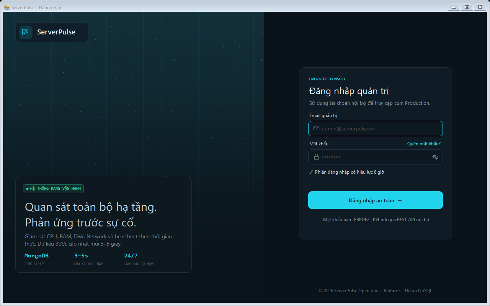
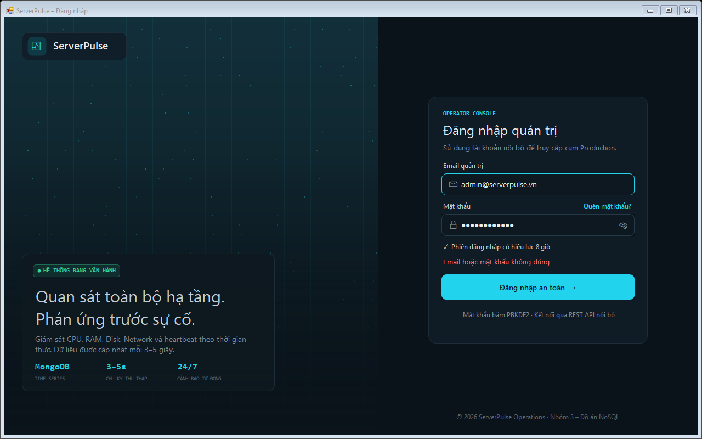
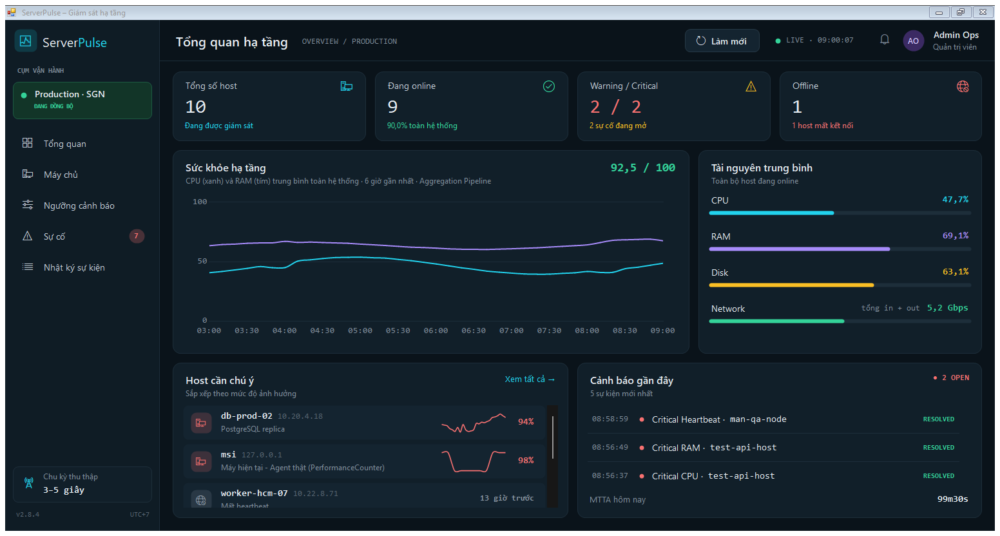
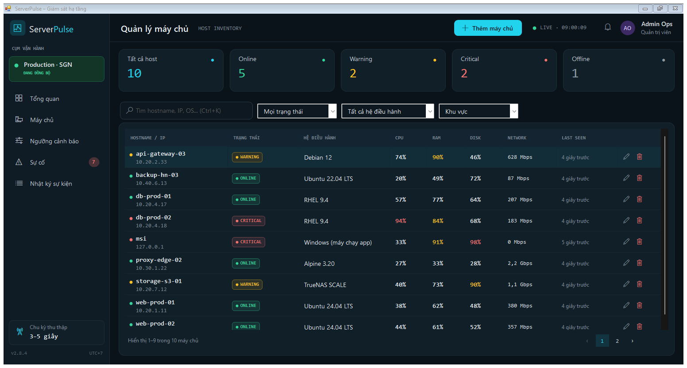
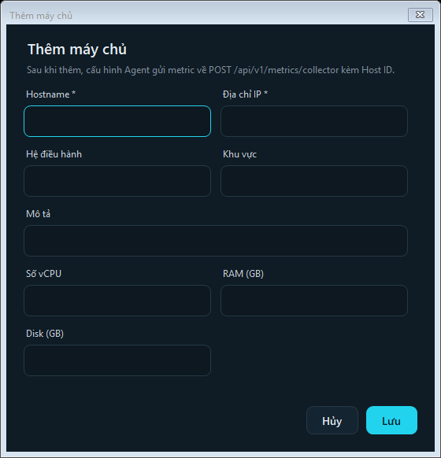
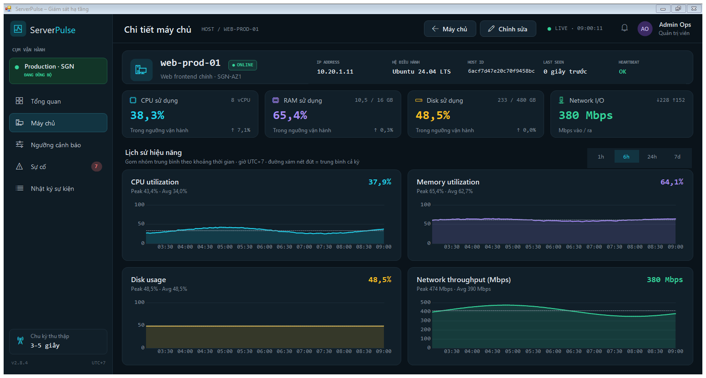
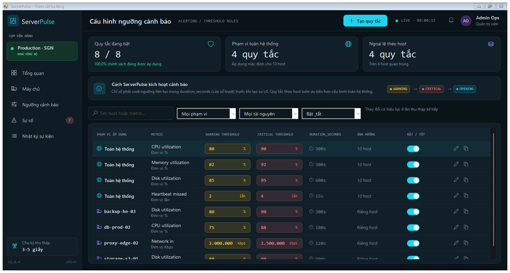
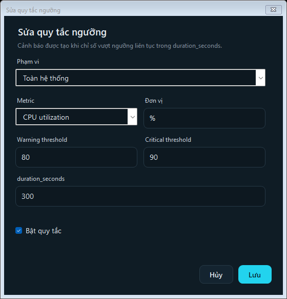
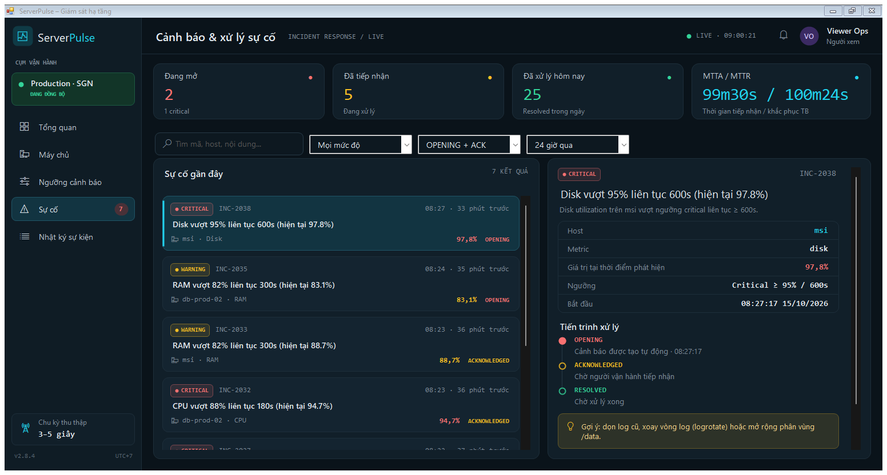
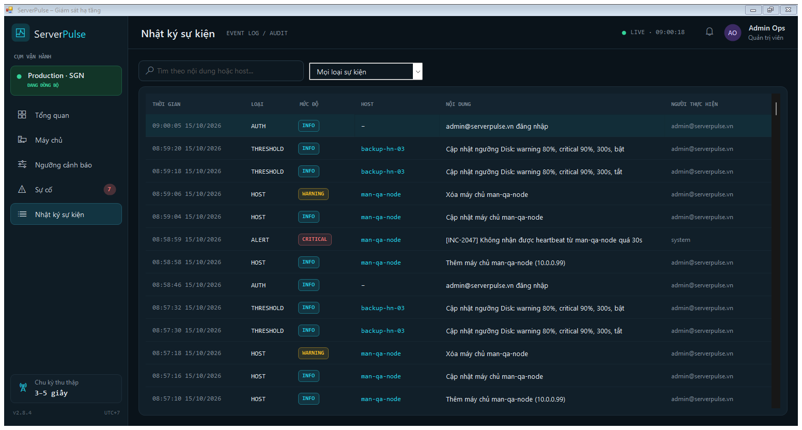

# TÀI LIỆU GIAO DIỆN, API VÀ HƯỚNG DẪN SỬ DỤNG – SERVERPULSE

> Đồ án NoSQL – Nhóm 3 – Đề tài: *Xây dựng hệ thống giám sát hiệu năng máy chủ và cảnh báo sự cố*
> Phần phụ trách: Nguyễn Thanh Phong (2001230665) – Giao diện, Dashboard, biểu đồ, Alert/Event Log, kiểm thử giao diện.
> Toàn bộ hệ thống viết bằng **C# (.NET Framework 4.7.2)**: backend, REST API, giao diện Windows Forms và bộ kiểm thử.
> Ảnh chụp màn hình nằm trong `Docs/screenshots/`, có thể chèn thẳng vào báo cáo Word.

---

## 1. Thiết kế giao diện

### 1.1. Kiến trúc

```
 Giao diện WinForms (C#)  ──HTTP/JSON──►  REST API (HttpListener, C#)  ──►  MongoDB
   FormLogin, FormMain, 6 trang            /api/v1/...                      servers, metrics, alert_rules,
   ApiClient (HttpClient)                  ApiServer.cs                     alert_events, event_logs, users
                                                ▲
 Agent / Collector (C#) ──POST /metrics/collector┘
```

| Thành phần | Công nghệ | Vị trí mã nguồn |
|---|---|---|
| Màn hình đăng nhập | Windows Forms | `Frontend/FormLogin.cs` |
| Khung ứng dụng (sidebar, thanh trên, điều hướng, tự làm mới 5 giây) | Windows Forms | `Frontend/FormMain.cs` |
| 6 trang chức năng | `UserControl` | `Frontend/Pages/*.cs` |
| Hộp thoại thêm/sửa máy chủ, quy tắc ngưỡng | Windows Forms | `Frontend/Dialogs.cs` |
| Bảng màu, font, icon, control tự vẽ (thẻ bo góc, nút, ô nhập, combobox tối…) | GDI+ | `Frontend/UI/Theme.cs`, `Frontend/UI/Controls.cs` |
| Biểu đồ | `System.Windows.Forms.DataVisualization.Charting` (có sẵn trong .NET Framework) | `Theme.LineChart()` |
| Client gọi API | `HttpClient` + `System.Text.Json` | `Backend/Api/ApiClient.cs` |
| Kiểu dữ liệu vào/ra của API (dùng chung server + client) | C# class | `Backend/Api/ApiDtos.cs` |
| REST API server | `System.Net.HttpListener` | `Backend/Api/ApiServer.cs` |

Giao diện **không truy cập MongoDB trực tiếp** mà gọi REST API giống như một Frontend thật. Vì vậy:
- quyền Admin/Viewer được kiểm tra ở API (trả 403), giao diện chỉ ẩn/khóa nút cho thân thiện;
- Agent bên ngoài, giao diện và bộ kiểm thử dùng chung một API.

### 1.2. Hệ thống thiết kế (Design System)

Giao diện dùng tông tối (dark theme) theo 6 hình thiết kế, phù hợp phòng vận hành (NOC): nhìn lâu ít mỏi mắt và các màu cảnh báo nổi bật hơn.

| Tên (Theme.cs) | Mã màu | Ý nghĩa sử dụng |
|---|---|---|
| `Bg` | `#0a131a` | Nền cửa sổ |
| `Panel` | `#0f1c25` | Sidebar, hộp thoại |
| `Card` / `Card2` | `#111f29` / `#142430` | Nền thẻ / nền dòng trong thẻ |
| `Line` | `#1d2e3a` | Đường viền |
| `Text` / `Muted` | `#e6edf3` / `#7d8b99` | Chữ chính / chữ phụ |
| `Cyan` | `#22d3ee` | Màu nhấn chính, nút chính, CPU |
| `Purple` | `#a78bfa` | RAM |
| `Amber` | `#fbbf24` | Disk, mức **WARNING**, trạng thái ACKNOWLEDGED |
| `Green` | `#34d399` | Network, **ONLINE**, RESOLVED |
| `Red` | `#f87171` | **CRITICAL**, OPENING, mất kết nối |
| `Gray` | `#8b98a5` | **OFFLINE** |

- **Font chữ:** *Segoe UI* cho nội dung, *Consolas* (mono) cho số liệu, hostname, IP và mã sự cố (số thẳng cột, dễ so sánh), *Segoe MDL2 Assets* cho icon (có sẵn trên Windows 10/11, không cần file ảnh).
- **Quy ước màu theo trạng thái:** áp dụng thống nhất cho chấm trạng thái, nhãn (pill), chữ số và biểu đồ (`Theme.StatusColor`). Chỉ số vượt ngưỡng warning tô vàng, vượt critical tô đỏ (`Theme.LevelColor`).
- **Control tự vẽ:** `RoundPanel` (thẻ bo góc 12px), `StatCard` (thẻ thống kê), `RoundButton` (5 kiểu: thường, chính, vàng, xanh, đỏ), `InputBox` (ô nhập có icon và chữ gợi ý), `DarkCombo`, `BarRow` (thanh tài nguyên), `Segmented` (chọn 1h/6h/24h/7d), `Toast` (thông báo nổi góc dưới phải).
- **Thanh tiêu đề và thanh cuộn tối** trên Windows 10/11 (`Theme.DarkTitleBar`, `Theme.DarkScroll`).
- **Bố cục:** sidebar trái (logo, cụm vận hành, menu có badge số sự cố, chu kỳ thu thập), thanh trên (tiêu đề, breadcrumb, nút hành động, đồng hồ LIVE, chuông, người dùng), vùng nội dung chia lưới bằng `TableLayoutPanel` nên co giãn theo kích thước cửa sổ (tối thiểu 1180×720).

---

## 2. Mô tả các màn hình

### 2.1. Đăng nhập – `FormLogin`


*Hình 1: Màn hình đăng nhập quản trị*

- **Bên trái:** logo ServerPulse trên nền tủ rack phát sáng, thẻ giới thiệu (“Hệ thống đang vận hành”, mô tả, MongoDB / 3–5s / 24/7).
- **Bên phải:** *Email quản trị*, *Mật khẩu* (biểu tượng con mắt để hiện/ẩn), nút **Đăng nhập an toàn** (nhấn Enter cũng được).
- **Kiểm tra dữ liệu** trước khi gọi API: email đúng định dạng, mật khẩu không trống. Sai tài khoản thì hiện thông báo đỏ (Hình 1b).


*Hình 1b: Thông báo khi nhập sai mật khẩu*

### 2.2. Tổng quan hạ tầng (Dashboard) – `OverviewPage`


*Hình 2: Dashboard tổng quan hạ tầng*

| Khu vực | Nội dung |
|---|---|
| 4 thẻ thống kê | Tổng số host · Đang online (% toàn hệ thống) · Warning / Critical (số sự cố đang mở) · Offline (số host mất kết nối) |
| Sức khỏe hạ tầng | Biểu đồ đường CPU (xanh) và RAM (tím) trung bình toàn hệ thống trong 6 giờ, gom nhóm 10 phút bằng **MongoDB Aggregation Pipeline**. Kèm *Health score* (0–100) |
| Tài nguyên trung bình | Thanh tiến trình CPU, RAM, Disk (%) và tổng băng thông Network của các host đang online |
| Host cần chú ý | Host CRITICAL → OFFLINE → WARNING, mỗi dòng có sparkline 2 giờ và giá trị cao nhất. Bấm vào để mở chi tiết host |
| Cảnh báo gần đây | 5 cảnh báo mới nhất (giờ, mức độ, metric, host, trạng thái xử lý), số sự cố OPEN và MTTA |

Nút **Làm mới** trên thanh trên tải lại ngay; ngoài ra mọi trang tự làm mới mỗi 5 giây.

### 2.3. Quản lý máy chủ – `HostsPage`


*Hình 3: Danh sách máy chủ*

- **5 thẻ đếm** Tất cả / Online / Warning / Critical / Offline. Bấm vào thẻ để lọc nhanh theo trạng thái (thẻ đang lọc có viền xanh).
- **Thanh công cụ:** ô tìm kiếm (hostname, IP, OS; phím tắt **Ctrl+K**), lọc trạng thái, lọc hệ điều hành, lọc khu vực, nút **Xuất CSV** (theo bộ lọc hiện tại, UTF-8 mở được bằng Excel).
- **Bảng:** Hostname/IP, Trạng thái, Hệ điều hành, CPU, RAM, Disk (tô vàng khi vượt warning, đỏ khi vượt critical), Network, Last seen, biểu tượng Sửa/Xóa (chỉ Admin). Bấm vào dòng để mở chi tiết.
- **Phân trang:** 9 máy chủ mỗi trang.
- Nút **+ Thêm máy chủ** (chỉ Admin) mở hộp thoại (Hình 3c): Hostname, IP (bắt buộc, có kiểm tra định dạng), Hệ điều hành, Khu vực, Mô tả, vCPU, RAM, Disk.


*Hình 3c: Hộp thoại thêm máy chủ*

### 2.4. Chi tiết máy chủ – `HostDetailPage`


*Hình 4: Chi tiết hiệu năng máy chủ web-prod-01*

- **Thẻ đầu trang:** hostname, nhãn trạng thái, mô tả · khu vực, IP, hệ điều hành, Host ID (dùng khi cấu hình Agent), last seen, heartbeat OK/LOST.
- **4 thẻ chỉ số hiện tại:** CPU (% / số vCPU), RAM (% / GB đã dùng), Disk (% / GB), Network (Mbps, chiều vào ↓ / ra ↑). Mỗi thẻ có dòng *Trong ngưỡng vận hành* / *Vượt ngưỡng warning* và mức biến động.
- **Lịch sử hiệu năng:** 4 biểu đồ CPU, Memory, Disk, Network; nút chọn **1h / 6h / 24h / 7d**. Đường xám nét đứt là trung bình cả kỳ; phụ đề ghi Peak / Avg; rê chuột lên đường để xem tooltip giá trị.
- Nút **← Máy chủ** quay lại danh sách, **Chỉnh sửa** (Admin) mở hộp thoại sửa.

### 2.5. Cấu hình ngưỡng cảnh báo – `ThresholdsPage`


*Hình 5: Cấu hình ngưỡng cảnh báo*

- **3 thẻ:** Quy tắc đang bật (x/y), Phạm vi toàn hệ thống, Ngoại lệ theo host.
- **Khung giải thích** cơ chế cảnh báo: Warning → Critical → Opening, cửa sổ trượt `duration_seconds`, quy tắc riêng host ưu tiên hơn quy tắc toàn hệ thống.
- **Bộ lọc:** tìm theo host/metric, phạm vi, tài nguyên, bật/tắt.
- **Bảng quy tắc:** phạm vi, metric + đơn vị, Warning threshold (ô vàng), Critical threshold (ô đỏ), duration_seconds, ảnh hưởng, **công tắc bật/tắt** (bấm để đổi ngay), biểu tượng Sửa và Nhân bản. Quy tắc đang tắt hiển thị mờ.
- **+ Tạo quy tắc** / Sửa mở hộp thoại (Hình 5b), kiểm tra Critical ≥ Warning, % ≤ 100.


*Hình 5b: Hộp thoại sửa quy tắc ngưỡng*

### 2.6. Cảnh báo & xử lý sự cố (Alert) – `IncidentsPage`


*Hình 6: Cảnh báo và xử lý sự cố*

- **4 thẻ:** Đang mở (kèm số critical), Đã tiếp nhận, Đã xử lý hôm nay, MTTA / MTTR.
- **Bộ lọc:** tìm theo mã INC / host / nội dung, mức độ, trạng thái (mặc định *OPENING + ACK*), khoảng thời gian 1 giờ / 24 giờ / 7 ngày. Nút **Lịch sử xử lý** mở Nhật ký sự kiện lọc sẵn loại ALERT.
- **Danh sách bên trái:** thẻ sự cố (mức độ, mã INC, giờ, tiêu đề, host · metric, giá trị, trạng thái); thẻ đang chọn có viền xanh.
- **Chi tiết bên phải:** bảng Host / Metric / Giá trị / Ngưỡng / Bắt đầu (bấm để mở chi tiết host), **timeline** OPENING → ACKNOWLEDGED → RESOLVED (giờ + người xử lý), gợi ý khắc phục theo loại metric, nút **Acknowledge** và **Resolve**.
- Badge đỏ trên menu “Sự cố” cho biết số sự cố chưa xử lý.


*Hình 8: Tài khoản Viewer – nút Acknowledge/Resolve bị khóa*

### 2.7. Nhật ký sự kiện (Event Log) – `EventsPage`


*Hình 7: Nhật ký sự kiện*

Ghi lại mọi sự kiện: **ALERT** (cảnh báo được tạo / tiếp nhận / xử lý), **HOST** (thêm/sửa/xóa máy chủ), **THRESHOLD** (tạo/sửa ngưỡng), **AUTH** (đăng nhập). Có tìm kiếm theo nội dung hoặc host và lọc theo loại. Cột *Người thực hiện* là `system` (tự động) hoặc email quản trị viên. Bấm tên host để mở chi tiết host.

---

## 3. Mô tả chức năng hệ thống

| # | Chức năng | Màn hình | Quyền | Mô tả |
|---|---|---|---|---|
| 1 | Đăng nhập / Đăng xuất | Đăng nhập, menu người dùng (bấm avatar) | Mọi người | Mật khẩu băm PBKDF2-SHA256 (100.000 vòng, salt riêng). Phiên dùng token ngẫu nhiên 256-bit, hết hạn sau 8 giờ; hết hạn thì app tự quay về màn hình đăng nhập |
| 2 | Phân quyền | Toàn hệ thống | — | **Admin**: toàn quyền. **Viewer**: chỉ xem. Kiểm tra ở cả API (403) và giao diện (ẩn/khóa nút) |
| 3 | Theo dõi tổng quan | Tổng quan | Admin, Viewer | Thống kê host theo trạng thái, sức khỏe hạ tầng, tài nguyên trung bình, host cần chú ý, cảnh báo gần đây |
| 4 | Quản lý máy chủ | Máy chủ | Xem: tất cả. Thêm/Sửa/Xóa: Admin | Tìm kiếm, lọc, phân trang, xuất CSV, thêm/sửa/xóa host. Xóa host thì xóa quy tắc riêng và đóng các sự cố còn mở của host |
| 5 | Kiểm tra hiệu năng | Chi tiết máy chủ | Admin, Viewer | Chỉ số hiện tại và biểu đồ lịch sử 1h/6h/24h/7d |
| 6 | Thiết lập ngưỡng | Ngưỡng cảnh báo | Xem: tất cả. Sửa: Admin | Tạo, sửa, nhân bản, bật/tắt quy tắc Warning/Critical/duration theo toàn hệ thống hoặc từng host |
| 7 | Phát hiện cảnh báo | (chạy nền) | Hệ thống | Alert Engine dùng cửa sổ trượt `duration_seconds`; không tạo trùng khi sự cố cũ chưa xử lý; heartbeat timeout 30 giây sinh cảnh báo mất kết nối |
| 8 | Xử lý sự cố | Sự cố | Xem: tất cả. Xử lý: Admin | OPENING → ACKNOWLEDGED → RESOLVED, lưu người và thời điểm, tính MTTA/MTTR |
| 9 | Nhật ký sự kiện | Nhật ký sự kiện | Admin, Viewer | Tra cứu lịch sử thao tác và cảnh báo |
| 10 | Thu thập dữ liệu | (chạy nền) | Hệ thống | Collector đo CPU (PerformanceCounter), RAM (GlobalMemoryStatusEx), Disk (DriveInfo), Network (NetworkInterface) của máy đang chạy app mỗi 5 giây. Agent bên ngoài gửi về `POST /api/v1/metrics/collector` |

---

## 4. Thiết kế Dashboard

Dashboard được thiết kế theo nguyên tắc **“tổng quát → chi tiết”**, đọc từ trên xuống, trái sang phải:

1. **Hàng 1 – “Có chuyện gì không?”**: 4 thẻ số lớn (Consolas 22pt). Người trực nhìn 3 giây là biết có host Critical/Offline hay không. Mỗi thẻ có icon và màu theo quy ước trạng thái.
2. **Hàng 2 – “Xu hướng ra sao?”**: biểu đồ sức khỏe 6 giờ (65% chiều ngang) và tài nguyên trung bình (35%).
3. **Hàng 3 – “Cần xử lý cái gì?”**: host cần chú ý (đã sắp theo mức nghiêm trọng) và cảnh báo gần đây. Bấm một host để đi thẳng tới trang chi tiết.

**Health score** = `100 − (2 × số host Critical + 1 × Warning + 1,5 × Offline) / tổng host × 10`, tối thiểu 0. Càng gần 100 thì hạ tầng càng ổn định.

**Cập nhật thời gian thực:** mỗi trang dựng khung một lần (`Build()`), sau đó `FormMain` gọi `RefreshAsync()` mỗi 5 giây để cập nhật số liệu và điểm biểu đồ tại chỗ. Việc làm mới tạm dừng khi đang mở hộp thoại hoặc cửa sổ bị thu nhỏ; lỗi kết nối hiện bằng toast thay vì làm treo app.

---

## 5. Thiết kế biểu đồ

| Biểu đồ | Màn hình | Loại | Dữ liệu | Ghi chú thiết kế |
|---|---|---|---|---|
| Sức khỏe hạ tầng | Tổng quan | Spline 2 đường | `GET /overview` → `series` (CPU/RAM trung bình mỗi 10 phút, 6 giờ) | Trục Y cố định 0–100% để so sánh giữa các lần xem |
| Tài nguyên trung bình | Tổng quan | Thanh tiến trình (`BarRow`) | `avgCpu`, `avgRam`, `avgDisk`, `totalNetMbps` | Màu CPU/RAM/Disk/Network thống nhất với các trang khác |
| Sparkline | Tổng quan | Đường cong mini (GDI+ `DrawCurve`) | `attention[].spark` (24 điểm, trung bình 5 phút) | Không trục, chỉ thể hiện xu hướng, màu theo trạng thái host |
| CPU utilization | Chi tiết host | SplineArea + đường trung bình nét đứt | `GET /metrics/history/{id}` → `points[].cpu` | Cyan |
| Memory utilization | Chi tiết host | SplineArea + trung bình | `points[].ram` | Tím |
| Disk usage | Chi tiết host | SplineArea + trung bình | `points[].disk` | Vàng |
| Network throughput | Chi tiết host | SplineArea + trung bình | `(netIn + netOut) / 1000` (Mbps) | Xanh lá, trục Y tự co giãn |

- **Giới hạn số điểm:** API gom nhóm trung bình để mỗi biểu đồ có tối đa khoảng 120 điểm ở mọi khoảng thời gian (1h → 30 giây/điểm, 7d → 84 phút/điểm), nên vẽ luôn nhanh.
- **Trục thời gian:** giờ địa phương (UTC+7), định dạng `HH:mm`; riêng 7 ngày là `dd/MM HH:mm`.
- **An toàn:** biểu đồ dùng lớp `SafeChart` – bỏ qua vẽ khi kích thước bằng 0 (thu nhỏ cửa sổ), tránh lỗi `ArgumentException` của Chart gốc.

---

## 6. Mô tả API

- **Base URL:** `http://localhost:5080/api/v1/`
- **Định dạng:** JSON (camelCase), enum dạng chuỗi (`"Cpu"`, `"Critical"`…), thời gian ISO-8601 UTC. Các kiểu dữ liệu khai báo trong `Backend/Api/ApiDtos.cs`.
- **Xác thực:** header `Authorization: Bearer <token>` lấy từ API đăng nhập. Chỉ `auth/login` và `metrics/collector` không cần token.
- **Mã lỗi:** `400` dữ liệu không hợp lệ · `401` chưa đăng nhập / token hết hạn · `403` không đủ quyền · `404` không tìm thấy · `409` xung đột (trùng tên, đã xử lý) · `503` mất kết nối MongoDB. Body lỗi: `{ "error": "..." }`.
- **Client C#:** `ApiClient` bọc toàn bộ API thành hàm `async` (ví dụ `await api.GetHostsAsync("db-prod")`), lỗi trả về được ném thành `ApiClientException` có `StatusCode`.

### 6.1. Xác thực

| Method | Endpoint | Quyền | Mô tả | Hàm ApiClient |
|---|---|---|---|---|
| POST | `/auth/login` | — | Body `{ email, password }` → `{ token, user: { email, fullName, role, expiresAt } }` | `LoginAsync` |
| GET | `/auth/me` | Đăng nhập | Thông tin phiên hiện tại | `GetMeAsync` |
| POST | `/auth/logout` | Đăng nhập | Hủy token | `LogoutAsync` |

### 6.2. Host (máy chủ)

| Method | Endpoint | Quyền | Mô tả | Hàm ApiClient |
|---|---|---|---|---|
| GET | `/hosts?q=&status=&os=` | Đăng nhập | Danh sách `HostView`: host + `latest` (metric mới nhất) + `status` (ONLINE/WARNING/CRITICAL/OFFLINE) + `lastSeen` | `GetHostsAsync` |
| GET | `/hosts/{id}` | Đăng nhập | Chi tiết một host | `GetHostAsync` |
| POST | `/hosts` | Admin | Thêm host. Body `{ name*, ipAddress*, operatingSystem, region, description, cpuCores, ramTotalGb, diskTotalGb }` | `CreateHostAsync` |
| PUT | `/hosts/{id}` | Admin | Sửa host | `UpdateHostAsync` |
| DELETE | `/hosts/{id}` | Admin | Xóa host + quy tắc riêng, đóng sự cố còn mở | `DeleteHostAsync` |

Ví dụ phản hồi `GET /hosts`:
```json
[{
  "host": { "id": "6acf7d47...", "name": "web-prod-01", "ipAddress": "10.20.1.11", "operatingSystem": "Ubuntu 24.04 LTS", "region": "SGN-AZ1" },
  "latest": { "timestamp": "2026-10-15T04:00:28Z", "cpuUsagePercent": 35.8, "ramUsagePercent": 63.5, "diskUsagePercent": 48.5, "networkInKbps": 272000, "networkOutKbps": 181000 },
  "status": "ONLINE",
  "lastSeen": "2026-10-15T04:00:28Z"
}]
```

### 6.3. Metrics (hiệu năng)

| Method | Endpoint | Quyền | Mô tả | Hàm ApiClient |
|---|---|---|---|---|
| POST | `/metrics/collector` | Agent (không cần token) | Body `CollectorBody { serverId*, cpu, ram, disk, networkInKbps, networkOutKbps }`. Kiểm tra Host ID tồn tại, CPU/RAM/Disk trong 0–100; ghi vào `metrics`; chạy Alert Engine | `CollectAsync` |
| GET | `/metrics/history/{id}?range=1h\|6h\|24h\|7d` | Đăng nhập | `HistoryDto { points[{ t, cpu, ram, disk, netIn, netOut }], summary{ cpuPeak, cpuAvg, … } }` | `GetHistoryAsync` |
| GET | `/metrics/latest/{id}` | Đăng nhập | Bản ghi metric mới nhất | — |
| GET | `/overview` | Đăng nhập | `OverviewDto`: total, online, warning, critical, offline, avgCpu/Ram/Disk, totalNetMbps, healthScore, series, attention, recentAlerts | `GetOverviewAsync` |

Ví dụ Agent gửi dữ liệu:
```bash
curl -X POST http://localhost:5080/api/v1/metrics/collector -H "Content-Type: application/json" -d "{\"serverId\":\"<HOST_ID>\",\"cpu\":42.5,\"ram\":61,\"disk\":48,\"networkInKbps\":1200,\"networkOutKbps\":800}"
```

### 6.4. Alert (cảnh báo / sự cố)

| Method | Endpoint | Quyền | Mô tả | Hàm ApiClient |
|---|---|---|---|---|
| GET | `/alerts?status=&severity=&q=&hours=24` | Đăng nhập | `AlertsDto { items, stats{ opening, openingCritical, acknowledged, resolvedToday, mttaSeconds, mttrSeconds } }`. `status=ACTIVE` = OPENING + ACKNOWLEDGED | `GetAlertsAsync` |
| GET | `/alerts/{id}` | Đăng nhập | Chi tiết sự cố | `GetAlertAsync` |
| POST | `/alerts/{id}/acknowledge` | Admin | OPENING → ACKNOWLEDGED (gọi lần 2 trả 409) | `AcknowledgeAsync` |
| POST | `/alerts/{id}/resolve` | Admin | → RESOLVED (đã RESOLVED trả 409) | `ResolveAsync` |

### 6.5. Event Log và Ngưỡng

| Method | Endpoint | Quyền | Mô tả | Hàm ApiClient |
|---|---|---|---|---|
| GET | `/events?q=&type=ALERT\|HOST\|THRESHOLD\|AUTH&take=200` | Đăng nhập | Nhật ký sự kiện, mới nhất trước | `GetEventsAsync` |
| GET | `/thresholds` | Đăng nhập | Danh sách quy tắc ngưỡng | `GetThresholdsAsync` |
| POST | `/thresholds` | Admin | Tạo quy tắc `{ serverId (null = toàn hệ thống), metric, unit, thresholdValue, criticalValue, durationSeconds, isEnabled }` | `SaveThresholdAsync` (Id rỗng) |
| PUT | `/thresholds/{id}` | Admin | Sửa / bật / tắt quy tắc | `SaveThresholdAsync` |

### 6.6. Collection MongoDB mà API sử dụng

| Collection | Nội dung | Index |
|---|---|---|
| `servers` | Danh mục máy chủ | — |
| `metrics` | Chuỗi thời gian CPU/RAM/Disk/Network | `{ServerId:1, Timestamp:-1}`, TTL 30 ngày trên `Timestamp` |
| `alert_rules` | Quy tắc ngưỡng | — |
| `alert_events` | Sự cố / cảnh báo | `{TriggeredAt:-1}` |
| `event_logs` | Nhật ký sự kiện | `{CreatedAt:-1}` |
| `users` | Tài khoản đăng nhập | `{Email:1}` unique |

---

## 7. Hướng dẫn sử dụng

### 7.1. Cài đặt và chạy

1. Cài **MongoDB Server** (6.0+) và bật service `MongoDB` (cổng 27017). Redis (`localhost:6379`) và Elasticsearch (`localhost:9200`) là tùy chọn – không có thì hệ thống vẫn chạy.
2. Mở và chạy bằng **một trong hai** cách (project dạng SDK, thư viện NuGet tự tải khi build; `nuget.config` đã trỏ sẵn tới nuget.org):
   - **VS Code:** cài .NET SDK và extension *C# Dev Kit*. *File → Open Folder* → chọn thư mục `HeThongGiamSatHieuNangMayChu`. Vào tab **Run and Debug** (Ctrl+Shift+D), chọn **“1. ServerPulse (giao diện)”** → nhấn **F5**. Build riêng: Ctrl+Shift+B. Chạy bằng dòng lệnh: `dotnet run --project Nhom3_NoSQL`.
   - **Visual Studio 2022:** mở `Nhom3_NoSQL.sln`, chọn project **Nhom3_NoSQL** làm Startup Project → nhấn **F5**.
5. Lần chạy đầu, hệ thống tự tạo database `Nhom3_NoSQL_Db`, index, 10 máy chủ (9 host demo + máy đang chạy), 7 ngày dữ liệu, 8 quy tắc ngưỡng, 6 sự cố mẫu và 2 tài khoản. Các lần sau, dữ liệu của host demo được bù cho khoảng thời gian app tắt.
6. Màn hình đăng nhập hiện ra. Tài khoản demo (khai báo trong `Database/DemoDataSeeder.cs`):

| Vai trò | Email | Mật khẩu |
|---|---|---|
| Admin (Quản trị viên) | admin@serverpulse.vn | Admin@123 |
| Viewer (Người xem) | viewer@serverpulse.vn | Viewer@123 |

7. Đóng cửa sổ chính là dừng toàn bộ hệ thống (API, Collector, mô phỏng). Đăng xuất thì quay lại màn hình đăng nhập.
8. Nếu khởi động lỗi, xem file `startup-error.log` cạnh file `.exe` (`Nhom3_NoSQL\bin\Debug\net472\`).

**Các chế độ chạy khác** (đặt trong *Project → Properties → Debug → Command line arguments* hoặc chạy từ dòng lệnh):

| Tham số | Tác dụng |
|---|---|
| *(không có)* | Chạy đầy đủ: API + Collector + giao diện |
| `--headless` | Chỉ chạy API + Collector, không mở giao diện (dùng khi chạy kiểm thử hoặc làm server cho máy khác); dừng bằng Task Manager |
| `--screenshots <thư mục>` | Tự mở lần lượt các màn hình và lưu ảnh PNG vào thư mục (dùng để lấy hình cho báo cáo) |

### 7.2. Các thao tác chính

| Mục đích | Thao tác |
|---|---|
| Xem tình trạng chung | Đăng nhập → **Tổng quan** |
| Tìm một máy chủ | **Máy chủ** → gõ tên/IP vào ô tìm kiếm (Ctrl+K), hoặc bấm thẻ *Critical / Offline* để lọc |
| Xem biểu đồ của một máy chủ | Bấm vào dòng máy chủ → chọn **1h / 6h / 24h / 7d** |
| Thêm máy chủ mới | **Máy chủ** → **+ Thêm máy chủ** → nhập Hostname, IP → **Lưu**. Mở chi tiết host để lấy **Host ID** rồi cấu hình Agent gửi về `POST /api/v1/metrics/collector` |
| Xuất danh sách | **Máy chủ** → **Xuất CSV** → chọn nơi lưu |
| Đổi ngưỡng cảnh báo | **Ngưỡng cảnh báo** → biểu tượng bút ở quy tắc cần sửa, hoặc bấm công tắc để bật/tắt |
| Đặt ngưỡng riêng cho 1 host | **Ngưỡng cảnh báo** → **+ Tạo quy tắc** → Phạm vi chọn host đó |
| Xử lý sự cố | **Sự cố** → chọn sự cố → **Acknowledge** (đã nhận) → khắc phục theo *Gợi ý* → **Resolve** |
| Truy vết ai đã làm gì | **Nhật ký sự kiện** → lọc loại *HOST / THRESHOLD / ALERT / AUTH* |
| Đăng xuất | Bấm avatar góc phải trên → **Đăng xuất** |

### 7.3. Ý nghĩa trạng thái máy chủ

| Trạng thái | Điều kiện |
|---|---|
| ONLINE | Có metric trong 30 giây gần nhất và không có sự cố đang mở |
| WARNING | Có sự cố mức Warning chưa xử lý |
| CRITICAL | Có sự cố mức Critical chưa xử lý |
| OFFLINE | Không nhận metric quá 30 giây (mất heartbeat) |

### 7.4. Chạy bộ kiểm thử tự động

- **VS Code:** Run and Debug → chọn **“4. Chạy app + kiểm thử cùng lúc”** → F5 (bộ test tự chờ API khởi động). Hoặc khi app đang chạy, chọn **“3. Kiểm thử tự động”**.
- **Visual Studio:** chạy app (F5), rồi chuột phải project **Nhom3_NoSQL.Tests** → *Debug → Start New Instance*.
- **Dòng lệnh:** `dotnet run --project Nhom3_NoSQL.Tests` (khi app đang chạy).

- **Test giao diện thủ công (TC-MAN-07..12) tự động:** khi app đang chạy, VS Code chọn cấu hình **“5. Kiểm thử thủ công tự động”**, hoặc chạy `Nhom3_NoSQL.Tests.exe --thu-cong`. Chương trình dùng chuột/bàn phím thật nên không chạm chuột trong khoảng 1 phút; ảnh và kết quả lưu ở `Docs/screenshots/kiem_thu_thu_cong/`. Nếu máy bật bộ gõ tiếng Việt (UniKey) vẫn chạy đúng vì dữ liệu nhập tránh các phím dấu Telex.

Kết quả in ra màn hình và lưu vào `Nhom3_NoSQL.Tests/ket_qua_kiem_thu.txt`. Chi tiết từng test case xem `Docs/TestCases.md`.

---

## 8. Danh sách hình (để chèn vào báo cáo)

| Hình | File | Nội dung |
|---|---|---|
| 1 | `screenshots/01_dang_nhap.png` | Màn hình đăng nhập |
| 1b | `screenshots/01b_dang_nhap_sai.png` | Báo lỗi đăng nhập sai |
| 2 | `screenshots/02_tong_quan.png` | Dashboard tổng quan |
| 3 | `screenshots/03_may_chu.png` | Quản lý máy chủ |
| 3c | `screenshots/03c_them_may_chu.png` | Hộp thoại thêm máy chủ |
| 4 | `screenshots/04_chi_tiet_may_chu.png` | Chi tiết máy chủ + 4 biểu đồ |
| 5 | `screenshots/05_nguong_canh_bao.png` | Cấu hình ngưỡng cảnh báo |
| 5b | `screenshots/05b_sua_nguong.png` | Hộp thoại sửa quy tắc ngưỡng |
| 6 | `screenshots/06_su_co.png` | Cảnh báo & xử lý sự cố |
| 7 | `screenshots/07_nhat_ky_su_kien.png` | Nhật ký sự kiện |
| 8 | `screenshots/08_phan_quyen_viewer.png` | Phân quyền – tài khoản Viewer |
